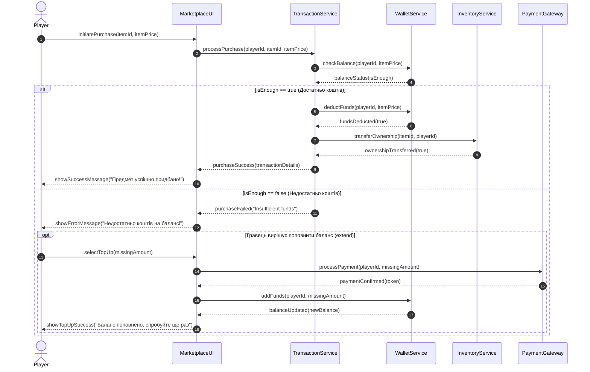

# Первинна генерація Sequence-діаграми (AI Trace 01)

## Prompt
На основі специфікації `lab3/spec.md` та прецеденту UC-01 «Купівля предмета» побудуй Sequence-діаграму у форматі Mermaid (`sequenceDiagram`). Учасники: `Player`, `MarketplaceUI`, `TransactionService`, `WalletService`, `InventoryService`, `PaymentGateway`. Покажи перевірку балансу через `alt` та опціональне поповнення через `opt`.

## Дослівна відповідь AI
Нижче наведено Sequence-діаграму у форматі Mermaid для сценарію купівлі предмета на маркетплейсі з використанням блоків `alt` та `opt`:

