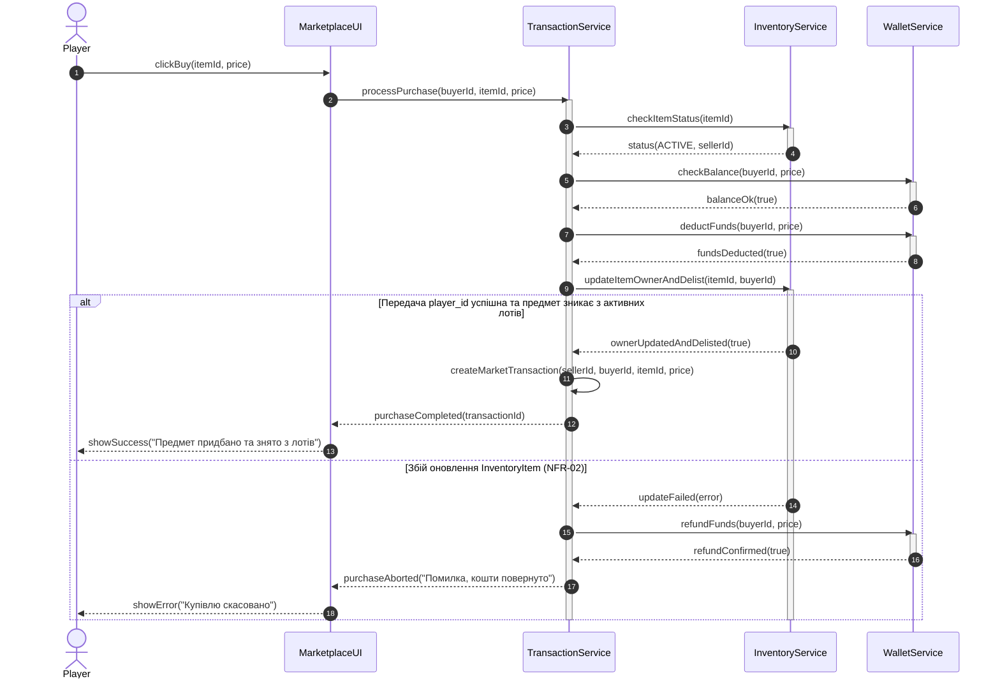
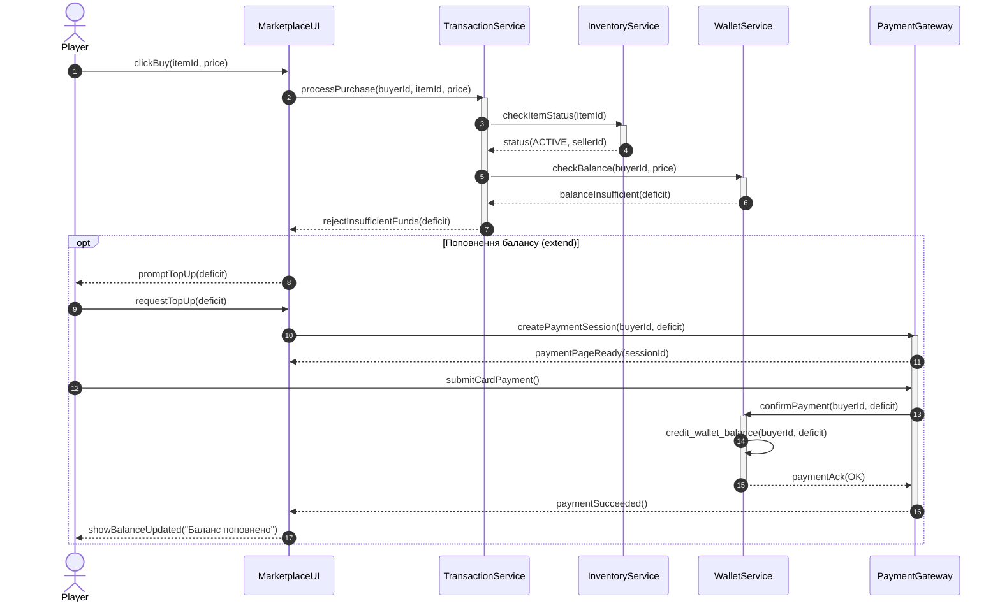
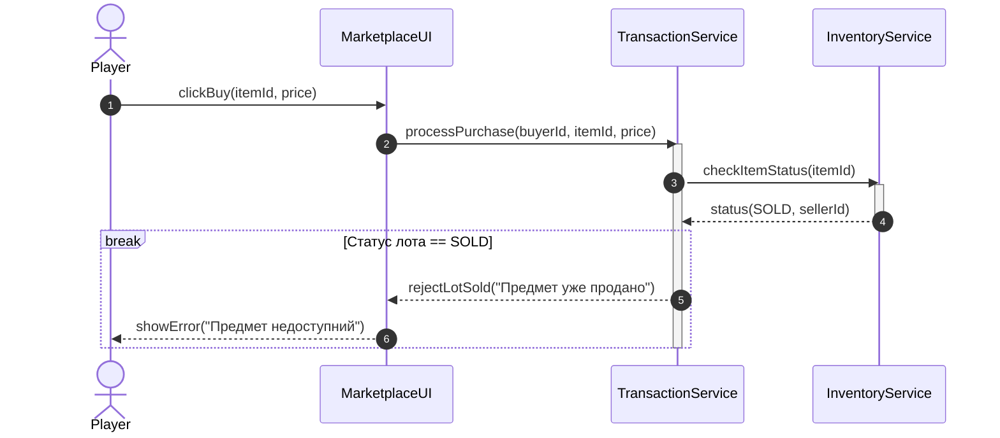

## Сценарій 1: Успішна купівля предмета та атомарність транзакції (NFR-02)

## Сценарій 2: Недостатньо коштів та поповнення через шлюз (REQ-05)

## Сценарій 3: Предмет уже продано (REQ-03, break)
