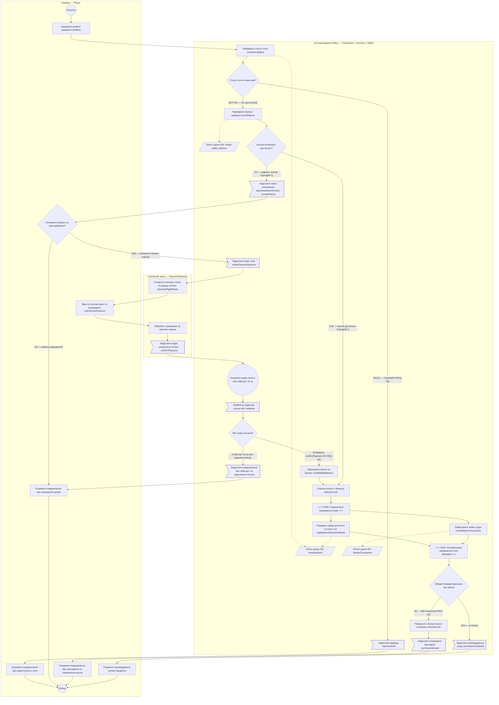

# Лабораторна робота №4: Моделювання бізнес-процесу (Activity Diagram)

## Артефакти роботи
- [`spec.md`](./spec.md) — специфікація бізнес-процесу `UC-01 «Купівля предмета»`, ролі, повідомлення, обґрунтування нотації та критерії прийняття (`AC-01`..`AC-06`).
- [`process.mmd`](./process.mmd) — декларативний опис Activity-діаграми у синтаксисі Mermaid `flowchart`.
- [`adr/0001-activity-diagram-and-payment-timeout.md`](./adr/0001-activity-diagram-and-payment-timeout.md) — архітектурне рішення (MADR) щодо вибору Activity-діаграми, обробки тайм-ауту шлюзу оплати та синхронізації `fork/join`.
- [`ai/`](./ai/) — слід роботи з AI: інтерв'ю та дозбір вимог (`01_initial_generation.md`) і аудит із виправленням топ-3 розбіжностей (`02_audit_and_refinement.md`).
- [`DEFENSE.md`](./DEFENSE.md) — документ захисту роботи за шаблоном DoD §4.

## Рендер діаграми діяльності (UC-01 «Купівля предмета»)

