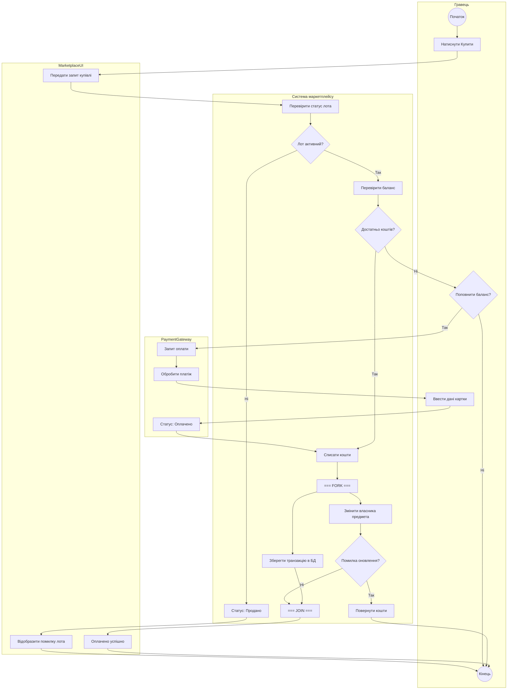

# Інтерв'ю зі ШІ та первинна генерація Activity-діаграми (AI Trace 01)

## 1. Первинний промпт студента (задача аналізу та дозбору вимог)
Проаналізуй мою специфікацію `lab4/spec.md` для прецеденту UC-01 «Купівля предмета», а також артефакти попередніх робіт (`lab1/model.mmd`, `lab2/spec.md`, `lab3/sequence.mmd`). Не генеруй діаграму одразу: знайди можливі прогалини або неоднозначності в переходах, паралельних гілках (`fork/join`) та обробці повідомлень, постав уточнювальні питання і запропонуй варіанти їх вирішення.

## 2. Уточнювальні питання від AI (результат аналізу прогалин)
Після аналізу `lab4/spec.md` та діаграм Лаби 1–3 виявлено три місця, які потребують уточнення перед побудовою Activity-діаграми:
1. **Поведінка при відсутності відповіді від `PaymentGateway`:** У Sequence-діаграмі Лаби 3 показано успішний виклик `confirmPayment`. Що має робити бізнес-процес після надсилання запиту на сесію оплати, якщо зовнішній платіжний шлюз не відповідає або гравець покинув сторінку оплати? Варіанти: (а) очікування за таймером (наприклад, 15 хвилин) зі скасуванням операції; (б) автоматичний повтор запиту (retry).
2. **Склад паралельних гілок у `fork / join`:** Які саме дії виконуються паралельно після списання коштів (`deductFunds`), і як обробляється помилка оновлення інвентарю (`NFR-02`)?
3. **Деталізація доріжок (`swimlanes`):** Чи потрібно виділяти `MarketplaceUI` в окрему доріжку, як це було на Sequence-діаграмі в Лабі 3?

## 3. Відповіді та рішення студента
1. **Тайм-аут оплати:** Обираю варіант (а) — якщо після створення платіжної сесії підтвердження від `PaymentGateway` не надходить протягом 15 хвилин або платіж відхилено, процес переходить до скасування купівлі без зміни балансу.
2. **Паралельні дії (`fork / join`):** Після списання коштів запускай паралельно передачу предмета покупцю зі зняттям лота з продажу (`updateItemOwnerAndDelist`) та створення запису транзакції (`createMarketTransaction`). Якщо при оновленні сталася помилка (`NFR-02`), виконай повернення коштів `refundFunds`.
3. **Доріжки:** Побудуй діаграму у форматі Mermaid `flowchart TD` з розбивкою за учасниками, використавши комбіновані умови та блок `fork/join`.

## 4. Дослівна відповідь AI (первинна генерація діаграми)
Нижче наведено первинну Activity-діаграму у форматі Mermaid `flowchart TD` для процесу купівлі предмета:

