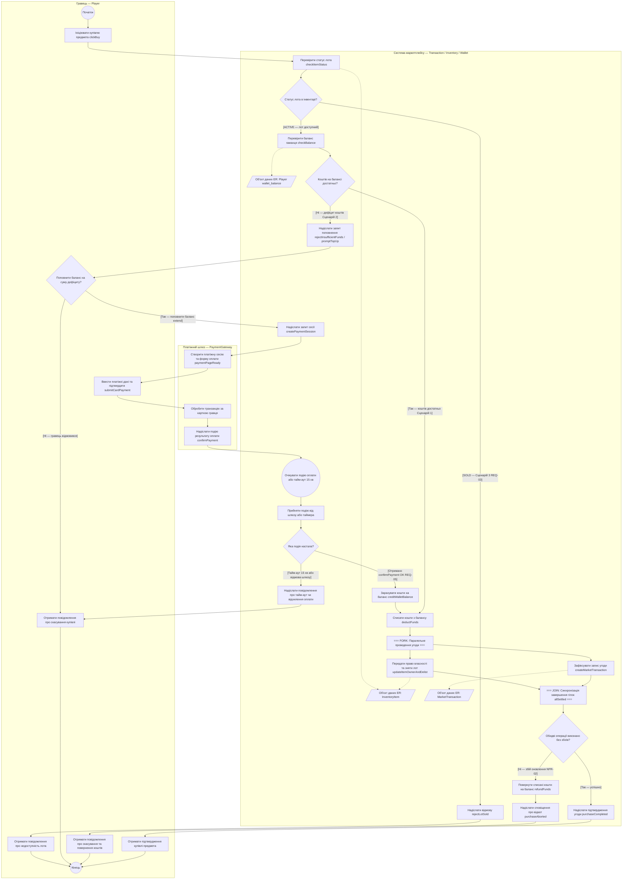

# Аудит первинної моделі та виправлення за результатами рев'ю (AI Trace 02)

## 1. Аудит первинної генерації (виявлені розбіжності зі `spec.md` та правилами моделювання)
Під час перевірки первинної діаграми (`ai/01_initial_generation.md`) виявлено топ-3 критичні помилки:
1. **Змішування нотацій (стани замість дій), зайва доріжка `MarketplaceUI` та згадка БД:** У блоках використано іменники-стани (`Статус: Продано`, `Статус: Оплачено`, `Оплачено успішно`) замість дієслів, додано доріжку `MarketplaceUI`, яка лише пересилає дані без власної бізнес-логіки, а крок збереження містить деталь реалізації «в БД» (порушення правил Activity-діаграм).
2. **Відсутність реакції на невідповідь зовнішньої системи та неузгодженість повідомлень із Sequence (Лаба 3):** Після надсилання запиту до `PaymentGateway` не показано очікування події та гілку тайм-ауту (15 хв), якщо відповідь не надійшла; назви повідомлень не містять точних сигналів із `lab3/sequence.mmd` (`createPaymentSession`, `confirmPayment`, `rejectLotSold`, `rejectInsufficientFunds`, `purchaseCompleted`, `purchaseAborted`).
3. **Достроковий вихід усередині паралельного блоку `fork / join` та відсутність вузлів даних ER:** У первинній діаграмі гілка `UpdateOwner` при помилці переходила на `Refund --> EndNode` в обхід `JoinNode`, через що `JoinNode` ніколи не дочекається завершення гілки (порушення семантики `Promise.allSettled`). Крім того, на схемі відсутні вузли даних (`object nodes`) із ER-моделі Лаби 1 (`InventoryItem`, `MarketTransaction`, `Player`).

## 2. Промпт на виправлення (після уточнення критеріїв `AC-04`..`AC-06` у `lab4/spec.md`)
Онови Activity-діаграму відповідно до розширених критеріїв `AC-01`..`AC-06` у `lab4/spec.md`:
1. Прибери доріжку `MarketplaceUI` та згадку «БД». Залиш три доріжки: `Гравець (Player)`, `Система маркетплейсу` та `Платіжний шлюз (PaymentGateway)`. Усі кроки назви дієсловами на рівні бізнес-процесу; умови на виходах з ромбів запиши вичерпно у квадратних дужках `[...]`.
2. Узгодь усі повідомлення (`send signal` / `accept event`) із Sequence-діаграмою Лаби 3 (`createPaymentSession`, `confirmPayment`, `rejectLotSold`, `promptTopUp`, `purchaseCompleted`, `purchaseAborted`) і додай подію очікування відповіді від шлюзу з гілкою тайм-ауту 15 хв.
3. Виправ блок `fork / join`: обидві паралельні гілки (`updateItemOwnerAndDelist` та `createMarketTransaction`) мають гарантовано сходитися в `join` (`allSettled`) без дострокових виходів, а перевірку успішності та компенсацію `refundFunds` (`NFR-02`) винеси одразу після `join`. Явно додай вузли даних ER-моделі (`InventoryItem`, `Player`, `MarketTransaction`).

## 3. Дослівна відповідь AI (виправлена Activity-діаграма)
Нижче наведено виправлену Activity-діаграму `flowchart TD`, яка повністю відповідає оновленій специфікації `lab4/spec.md`:

