# Лабораторна робота №5: Архітектура системи (Component Diagram — Варіант A: Горизонтальні шари)

## Артефакти роботи
- [`spec.md`](./spec.md) — специфікація компонентної архітектури, портів, контрактів `lollipop/socket`, прямих залежностей і критеріїв прийняття (`AC-01`..`AC-06`).
- [`architecture.mmd`](./architecture.mmd) — декларативний опис UML Component Diagram у синтаксисі Mermaid.
- [`adr/0001-layered-component-architecture.md`](./adr/0001-layered-component-architecture.md) — архітектурне рішення (MADR) щодо вибору горизонтальних шарів і правил розмежування портів та `lollipop`.
- [`ai/`](./ai/) — слід роботи з AI: архітектурне інтерв'ю (`01_initial_generation.md`) та аудит із усуненням топ-3 типових помилок (`02_audit_and_refinement.md`).
- [`DEFENSE.md`](./DEFENSE.md) — документ захисту роботи з перевіркою узгодженості всього ланцюга моделей (Лаби 1–5).

## Рендер компонентної діаграми (`In-Game Marketplace System`)

```mermaid
flowchart TB
    Player(["Гравець (Actor)"])

    subgraph SystemBoundary ["Межа системи: In-Game Marketplace System"]
        subgraph Presentation ["Presentation (браузер — окремий процес)"]
            LotPage["«component»\nCatalog & Lot Page\n(clickBuy)"]
            WalletPage["«component»\nWallet & Top-Up Page\n(promptTopUp)"]
        end

        I_REST(("REST /api\n(lollipop)"))
        I_WS(("WS /events\n(lollipop)"))

        subgraph Backend ["«component» Marketplace Backend (один процес · межа = порти)"]
            pHttp["[portin] HTTP in"]
            pWs["[portout] WS out"]
            pWh["[portin] webhook in"]
            pOidc["[portout] OIDC out"]
            pPsp["[portout] PSP out"]
            pMsg["[portout] email/push out"]

            subgraph API_Pkg ["package: API (controllers)"]
                Router["«component»\nRouter\n(визначений фреймворком)"]
                AuthM["«component»\nAuthMiddleware\n(токен гравця)"]
                AuthC["«component»\nAuthController"]
                PurchC["«component»\nPurchaseController\n(UC-01 clickBuy)"]
                InvC["«component»\nInventoryController"]
                WebhookC["«component»\nPaymentWebhookController\n(confirmPayment)"]
                TimeoutJob["«component»\nPaymentTimeoutJob\n(cron: тайм-аут 15 хв)"]
            end

            subgraph Svc_Pkg ["package: Services (business logic)"]
                AuthS["«component»\nAuthService"]
                TxS["«component»\nTransactionService\n(UC-01, fork/join allSettled, refundFunds NFR-02)"]
                InvS["«component»\nInventoryService\n(checkItemStatus REQ-03, updateOwner)"]
                WalS["«component»\nWalletService\n(checkBalance, deduct, credit REQ-05)"]
                NotifS["«component»\nNotificationService"]
            end

            subgraph DAL_Pkg ["package: Data access (repositories)"]
                PlayerR["«component»\nPlayerRepository\n(Player, wallet_balance)"]
                InvR["«component»\nInventoryRepository\n(InventoryItem)"]
                TxR["«component»\nTransactionRepository\n(MarketTransaction)"]
            end

            pSql["[portout] SQL out"]
        end

        I_SQL(("SQL\n(lollipop)"))
        DB[("«database»\nMarketplace DB\n(окремий процес · одна спільна схема:\nPlayer, InventoryItem, MarketTransaction)")]
    end

    IdP["«external»\nGameIdentityProvider\n(OAuth 2.0 / Steam OpenID)"]
    I_OIDC(("OIDC\n(lollipop)"))

    MsgExt["«external»\nNotificationProvider\n(Email / Push)"]
    I_Msg(("Email / Push API\n(lollipop)"))

    PayGW["«external»\nPaymentGateway\n(Payments API + Payment Page)"]
    I_Webhook(("Webhook\n(lollipop)"))
    I_PSP(("Payments API\n(lollipop)"))

    Player --> LotPage
    Player --> WalletPage
    Player -.->|"redirect -> оплата на Payment Page (REQ-05)"| PayGW

    LotPage -.->|"socket (required)"| I_REST
    WalletPage -.->|"socket (required)"| I_REST
    pHttp ---|"lollipop (provided)"| I_REST

    LotPage -.->|"socket (required)"| I_WS
    pWs ---|"lollipop (provided)"| I_WS

    pHttp -->|"delegation"| Router
    pWh -->|"delegation"| WebhookC

    Router -.-> AuthM
    Router -.-> AuthC
    Router -.-> PurchC
    Router -.-> InvC

    AuthC -.-> AuthS
    AuthM -.-> AuthS
    PurchC -.-> TxS
    InvC -.-> InvS
    WebhookC -.-> WalS
    WebhookC -.-> TxS
    TimeoutJob -.-> TxS

    TxS -.-> InvS
    TxS -.-> WalS
    TxS -.-> NotifS

    AuthS -.-> PlayerR
    WalS -.-> PlayerR
    InvS -.-> InvR
    TxS -.-> InvR
    TxS -.-> TxR

    NotifS -->|"delegation"| pWs
    NotifS -->|"delegation"| pMsg
    AuthS -->|"delegation"| pOidc
    WalS -->|"delegation"| pPsp

    PlayerR -->|"delegation"| pSql
    InvR -->|"delegation"| pSql
    TxR -->|"delegation"| pSql

    pOidc -.->|"socket (required)"| I_OIDC
    IdP ---|"lollipop (provided)"| I_OIDC

    pMsg -.->|"socket (required)"| I_Msg
    MsgExt ---|"lollipop (provided)"| I_Msg

    PayGW -.->|"socket (required: confirmPayment)"| I_Webhook
    pWh ---|"lollipop (provided)"| I_Webhook

    pPsp -.->|"socket (required: createPaymentSession)"| I_PSP
    PayGW ---|"lollipop (provided)"| I_PSP

    pSql -.->|"socket (required)"| I_SQL
    DB ---|"lollipop (provided)"| I_SQL
```

