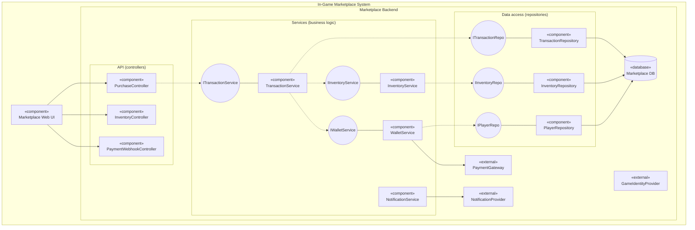

# Інтерв'ю зі ШІ та первинна генерація Component Diagram (AI Trace 01)

## 1. Первинний промпт студента (аналіз прогалин і дозбір вимог)
Проаналізуй мою специфікацію `lab5/spec.md` та попередні моделі проєкту (`lab1/model.mmd`, `lab2/spec.md`, `lab3/sequence.mmd`, `lab4/process.mmd`). Не генеруй діаграму одразу: перевір узгодженість між учасниками Sequence, доріжками Activity, сутностями ER та правилами побудови UML Component Diagram (Варіант A — горизонтальні шари) і постав уточнювальні запитання.

## 2. Уточнювальні питання від AI (аналіз прогалин)
Після аналізу `lab5/spec.md` та артефактів Лаб 1–4 виявлено три питання щодо декомпозиції компонентів:
1. **Декомпозиція доріжки `Система маркетплейсу` та обробка тайм-ауту 15 хв (Лаба 4):** У Лабі 4 система очікує подію `confirmPayment` від `PaymentGateway` або скасовує угоду за тайм-аутом 15 хв. Які саме компоненти шару `API` приймають асинхронний вебхук від платіжного шлюзу і хто ініціює перевірку прострочених сесій оплати?
2. **Правило вибору між `lollipop` та прямою залежністю (`..>`):** Де саме в шаруватій архітектурі Варіанта A мають стояти контракти `lollipop/socket`, а де — прямі пунктирні залежності?
3. **Робота з базою даних ER-моделі (Лаба 1):** Чи звертаються репозиторії до спільної бази `Marketplace DB` через один вихідний порт `SQL out`, і які саме репозиторії відповідають таблицям `Player`, `InventoryItem`, `MarketTransaction`?

## 3. Відповіді та рішення студента
1. **Вебхук і тайм-аут:** Зовнішній `PaymentGateway` викликає контракт `Webhook`, який надає наш бекенд через окремий вхідний порт `webhook in` напряму в `PaymentWebhookController` (в обхід `Router`). А для контролю 15-хвилинного тайм-ауту в шарі `API` працює `PaymentTimeoutJob (cron)`, який викликає `TransactionService`.
2. **Контракти vs прямі залежності:** `Lollipop` та `socket` ставимо лише на межі процесів (у парі з портами на межі `Marketplace Backend`: `REST /api`, `WS /events`, `Webhook`, `Payments API`, `OIDC`, `Email / Push API`, `SQL`). Усередині бекенду (`Controller → Service → Repository`) використовуємо виключно пунктирні стрілки прямої залежності (`..>`), бо міняти реалізацію репозиторію чи сервісу в межах моноліту не планується.
3. **Репозиторії та БД:** Три репозиторії (`PlayerRepository`, `InventoryRepository`, `TransactionRepository`) працюють у шарі `Data access` і через єдиний вихідний порт `SQL out` звертаються до контракту `SQL` окремого процесу `Marketplace DB` (одна спільна схема). Згенеруй декларативну діаграму в Mermaid.

## 4. Дослівна відповідь AI (первинна генерація діаграми)
Нижче наведено первинну діаграму компонентів у синтаксисі Mermaid:

